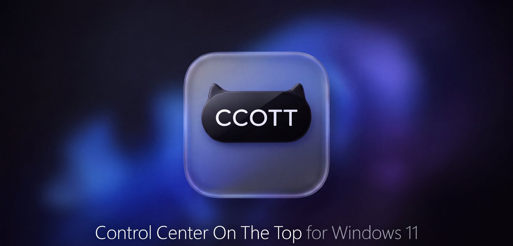
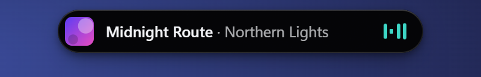
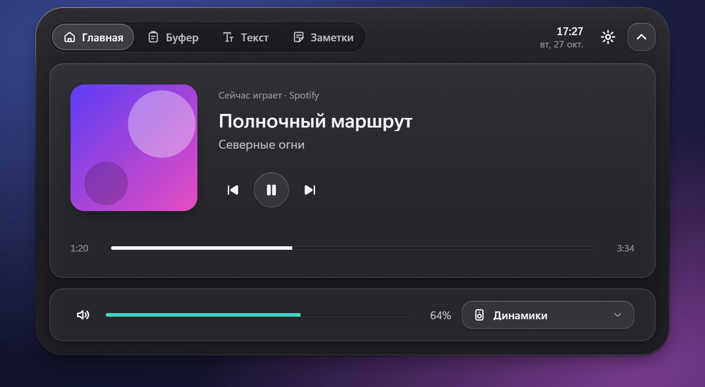
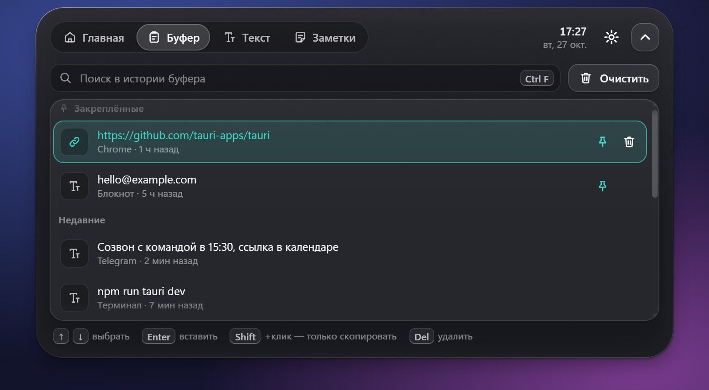
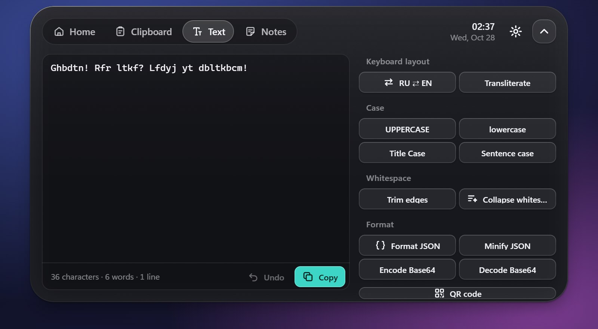
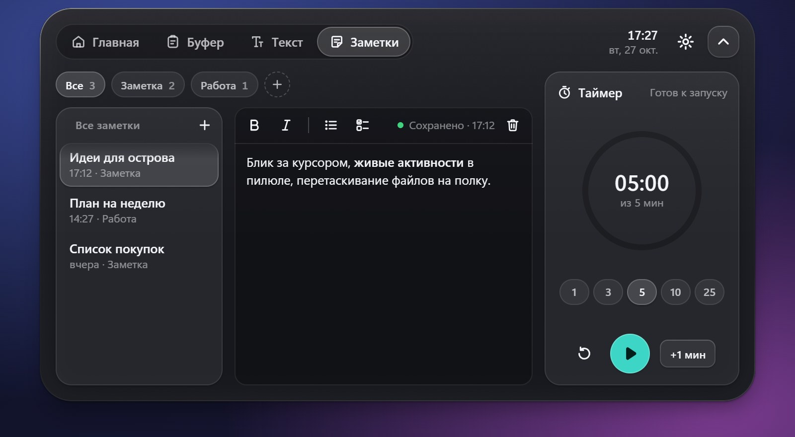
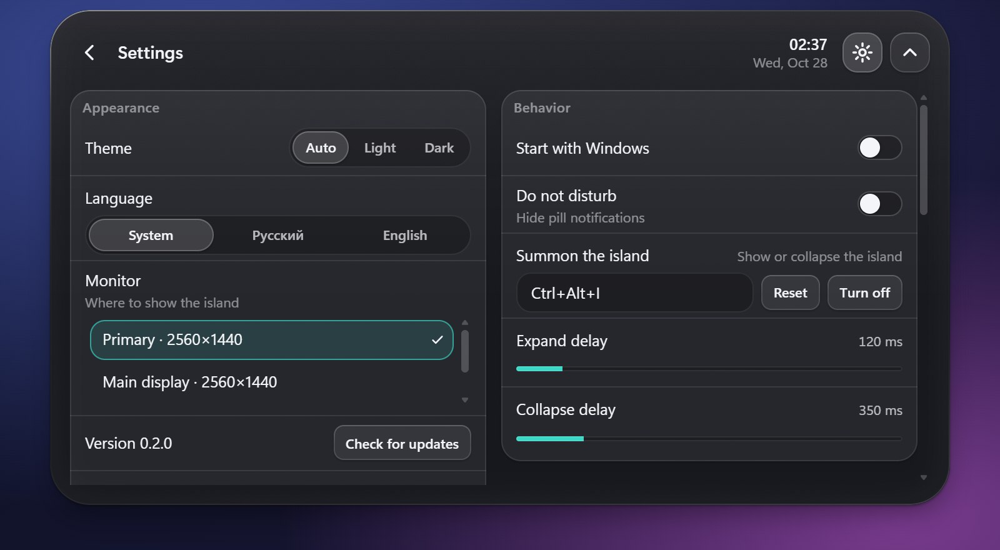
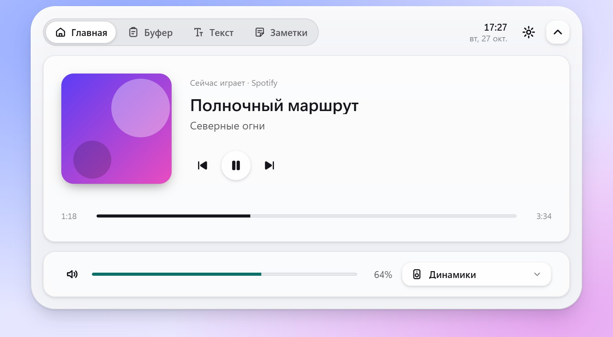

<p align="center">
  
</p>

<p align="center">
  <a href="https://github.com/sshyngys1/ccott/releases/latest"></a>
  
  
  <a href="LICENSE"></a>
</p>

<p align="center">
  <b>A Dynamic Island–style control center that lives at the top of your Windows desktop.</b><br/>
  Media, volume, clipboard history, screenshots and OCR, a color picker, QR codes, an app dock, text tools, notes and a<br/>
  focus timer — one hover away. In English and Russian.
</p>

<p align="center">
  
</p>

---

## Why CCOTT

Windows spreads everyday controls across the taskbar, the tray, the volume flyout and a dozen small utilities.
CCOTT gathers them into a single glass pill at the top of the screen. It stays out of the way, shows what matters
right now — the playing track, a running timer, a "Copied" toast — and expands into a full panel when you hover it
or press a hotkey.

## Features

| | |
| --- | --- |
| 🎵 **Now playing** | Works with any app that reports to Windows media controls (Spotify, browsers, Media Player…): artwork, title, seek bar, play/pause/next/previous. |
| 🔊 **Volume & output** | System volume and mute, scroll the mouse wheel over the volume card, switch the output device. |
| 📋 **Clipboard history** | Text, links, images and files with search and pinning. Click an entry to paste it into the app you were using; Shift+click only copies. Content from password managers is never recorded. |
| ✍️ **Text tools** | Fix text typed in the wrong keyboard layout (RU ⇄ EN), transliteration, letter case, whitespace cleanup, JSON pretty/minify, Base64, live character/word/line counts. |
| 📸 **Screenshots & OCR** | Capture a region or the whole screen to the clipboard (Shift+click saves a PNG to `Pictures\Screenshots\CCOTT`). Copy text from anywhere on screen with offline Windows OCR. |
| 🎯 **Color picker & QR** | Pick any pixel with a magnifier and copy its HEX. Scan a QR code on screen (links get an Open button) or turn text into a QR image. |
| 🗂️ **Dock** | Drop apps, folders and files onto the island to pin them, open them with a click, drag them out to copy them anywhere. |
| 🗒️ **Notes & timer** | Rich-text notes in folders with autosave, plus a focus timer with presets that keeps counting in the pill while the island is collapsed. |
| ⌨️ **Summon hotkey** | `Ctrl+Alt+I` (configurable) shows the island anywhere — even over a fullscreen app or game in borderless mode. |
| 🖥️ **Stays out of the way** | Hides in fullscreen apps and over maximized browsers, so your tabs stay clickable; choose the apps yourself. Hold the cursor at the top edge or press the hotkey to bring it back. |
| ⚙️ **Settings** | English or Russian (follows Windows by default), light/dark/auto theme, monitor selection, start with Windows, Do Not Disturb, hover delays. |
| 🔄 **Auto-update** | Signed updates from GitHub Releases, checked in the background or on demand. |

## Screenshots

<table>
  <tr>
    <td></td>
    <td></td>
  </tr>
  <tr>
    <td align="center"><sub>Home — player, volume, quick tools, dock</sub></td>
    <td align="center"><sub>Clipboard history with pinned items</sub></td>
  </tr>
  <tr>
    <td></td>
    <td></td>
  </tr>
  <tr>
    <td align="center"><sub>Text tools</sub></td>
    <td align="center"><sub>Notes and focus timer</sub></td>
  </tr>
  <tr>
    <td></td>
    <td></td>
  </tr>
  <tr>
    <td align="center"><sub>Settings</sub></td>
    <td align="center"><sub>Light theme</sub></td>
  </tr>
</table>

<sub>Screenshots use sample data.</sub>

## Download

Grab the installer from the [**latest release**](https://github.com/sshyngys1/ccott/releases/latest):

- `CCOTT_x.y.z_x64-setup.exe` — recommended installer (per-user, no admin rights needed);
- `CCOTT_x.y.z_x64_en-US.msi` / `..._ru-RU.msi` — MSI packages for managed deployments.

Requirements: Windows 11 (Windows 10 may work but is not tested) and the Microsoft Edge WebView2 Runtime, which
ships with Windows 11.

> [!NOTE]
> The installer is not code-signed yet, so Windows SmartScreen may show "Windows protected your PC".
> Click **More info → Run anyway**. Updates themselves are cryptographically signed and verified.

## Using CCOTT

| Action | How |
| --- | --- |
| Open the panel | Hover the pill at the top of the screen |
| Summon / hide anywhere | `Ctrl+Alt+I` (change it in Settings); `Esc` closes it again |
| Show the hidden pill over a browser | Hold the cursor at the top edge of the screen for a moment |
| Pin an app, folder or file | Drag it onto the island, or press `+` in the dock |
| Screenshot / text from screen | Click a tile on Home and drag a region; `Esc` or right click cancels |
| Paste from history | Click an entry, or select it with `↑` `↓` and press `Enter` |
| Copy without pasting | `Shift`+click or `Shift`+`Enter` |
| Change volume | Scroll over the volume card |
| Settings, autostart, quit | Gear icon in the panel, or the tray icon |

## Privacy

Everything stays on your computer. Clipboard history and notes are stored in a local SQLite database and settings in
`settings.json`, both in `%APPDATA%\dev.islandwin.app`. The only network request CCOTT makes is checking
GitHub Releases for updates. Clipboard entries marked as private by password managers are skipped, and copied text
that looks like a password is masked in the pill.

## Build from source

Requirements: Node.js 24+, a stable Rust toolchain (MSVC), Visual Studio Build Tools with
**Desktop development with C++**, and the WebView2 Runtime.

```powershell
git clone https://github.com/sshyngys1/ccott.git
cd ccott
npm ci
npm run tauri dev      # run the app
npm run dev            # UI only, in a browser with mock data (http://localhost:1420)
npm run tauri build    # installers in src-tauri/target/release/bundle/
```

Checks:

```powershell
npm run typecheck
npm test
cargo test --manifest-path src-tauri/Cargo.toml
cargo clippy --manifest-path src-tauri/Cargo.toml --all-targets -- -D warnings
```

### Project layout

| Path | Purpose |
| --- | --- |
| `src/shell/` | Island window, pill, navigation, settings |
| `src/modules/` | Home, Clipboard, Text and Notes tabs |
| `src/design/` | Design tokens, glass styles, icons, motion |
| `src/ipc/` | Typed calls to Rust and the browser mock |
| `src/lib/` | Module logic and state |
| `src-tauri/src/` | Rust backend: window, media (SMTC), audio, clipboard, storage, hotkeys, updater |
| `docs/` | IPC contracts, design spec, release guide |

Built with [Tauri 2](https://tauri.app), Rust, React 19, TypeScript, Vite, Motion, Zustand and SQLite.

## Roadmap

| Version | Planned |
| --- | --- |
| ✅ **0.2** — Quick tools | English interface, screenshots, offline OCR, color picker, QR codes, app and folder dock, auto-hide over browsers, automated release builds |
| **0.2.x** | Bug fixes from Issues, a faster first expand after a long idle period |
| **0.3** — Command bar & files | Command bar on a hotkey (apps, files, calculator, unit and currency converter, quick timers), file shelf (drop files on the pill and drag them out), download monitor, winget package |
| **0.4** — Info & controls | Weather with hourly and 7-day forecasts and rain alerts, quick controls (Wi-Fi, Bluetooth, dark mode, power mode, Bluetooth headset battery), natural-language reminders, AI coding agent status (e.g. Claude Code is waiting or done) |
| **0.5** — Media & polish | Synced song lyrics, audio visualizer, screen recording to MP4, native Mica/Acrylic backdrop |
| **1.0** — Stable | Code-signed installer, idle footprint under 60 MB RAM and 0% CPU, Windows 10 and multi-monitor/mixed-DPI testing, docs for writing modules |
| **Later** | Windows notifications in the pill, original desktop pets, optional AI features (bring your own key or a local model) |

Plans may change based on feedback.

Ideas and bug reports are welcome in [Issues](https://github.com/sshyngys1/ccott/issues).

## Contributing

See [CONTRIBUTING.md](CONTRIBUTING.md). Releases are described in [docs/RELEASING.md](docs/RELEASING.md).

## License

[PolyForm Noncommercial 1.0.0](LICENSE) © 2026 sshyngys1. Free to use, study, modify and share for any noncommercial purpose; selling CCOTT or a modified version, or other commercial use, needs the author's written permission. Versions up to 0.2.1 were released under MIT.

CCOTT is an independent project inspired by the Dynamic Island idea and is
not affiliated with Apple or Microsoft.
