<p align="center">
  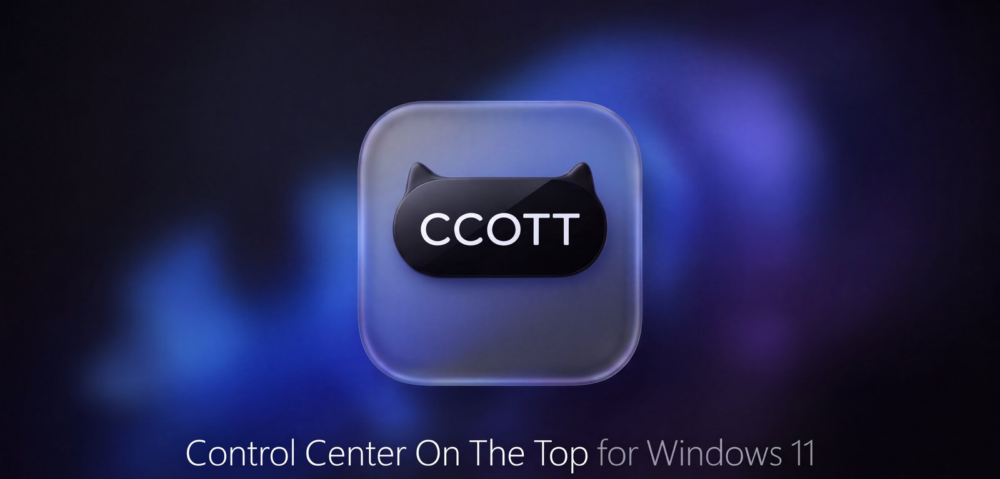
</p>

<p align="center">
  <a href="https://github.com/sshyngys1/ccott/releases/latest"></a>
  
  
  <a href="LICENSE"></a>
</p>

<p align="center">
  <b>A Dynamic Island–style control center that lives at the top of your Windows desktop.</b><br/>
  A command bar, media, volume, clipboard history, a file shelf, a downloads monitor, screenshots and OCR, a color picker,<br/>
  QR codes, synced lyrics, weather, quick controls, reminders and coding agent status — one hover or one hotkey away. In English and Russian.
</p>

<p align="center">
  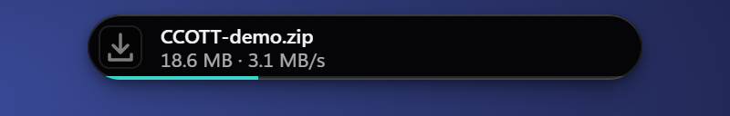
  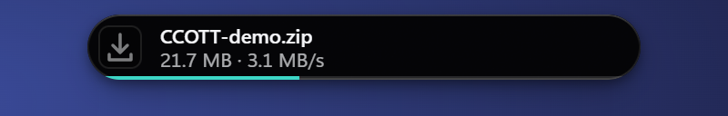
</p>

<p align="center">
  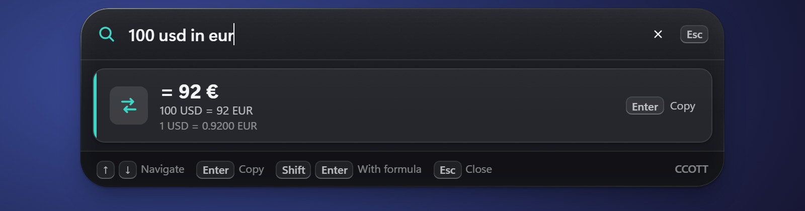
</p>

---

## Why CCOTT

Windows spreads everyday controls across the taskbar, the tray, the volume flyout and a dozen small utilities.
CCOTT gathers them into a single glass pill at the top of the screen. It stays out of the way, shows what matters
right now — the playing track, a running timer, a "Copied" toast — and expands into a full panel when you hover it
or press a hotkey.

## Features

| | |
| --- | --- |
| ⌨️ **Command bar** | `Ctrl+Alt+Space` from anywhere: launch apps (`Ctrl+Enter` — as administrator), find files and folders, calculate (`12*7+3`, `15% of 2400`), convert units (`5 km in miles`) and currencies with live rates (`100 usd in eur`), start a timer (`timer 10 min`) or a reminder. Set a default target currency and pick currency codes or names from autocomplete. |
| 🗄️ **File shelf** | Drop files on the collapsed pill and choose **Shelf** in **Dock or Shelf** to park them, then drag one or several out of the Shelf tab into any app. Choose whether a dragged file stays and how long the shelf keeps files. |
| ⬇️ **Downloads monitor** | Browser downloads show in the pill with a progress bar, name, size and speed; when done, open the file or its folder in one click. |
| 🎵 **Now playing** | Works with any app that reports to Windows media controls (Spotify, browsers, Media Player…): artwork, title, seek bar, play/pause/next/previous. |
| 🎶 **Synced lyrics** | Follow scrolling lines with soft blur, seek by clicking a line, and see the current line in a pill that fits the text, with the island colored to match the artwork. Lyrics come from the open [LRCLIB database](https://lrclib.net); online lookup can be turned off in Settings → Lyrics. |
| 🎛️ **Control center** | Toggle Wi-Fi, Bluetooth and the Windows dark theme, switch power mode, and see paired Bluetooth devices with battery levels when available. |
| 🌦️ **Weather** | Current conditions, hourly and 7-day forecasts, plus “rain in N minutes” in the pill. Choose a city or detect your location; powered by Open-Meteo with no API key. |
| ⏰ **Reminders** | Type a reminder in English or Russian in the command bar or Notes, such as `remind me in 20 minutes to take a break`. When it is due, mark it Done or snooze it from the toast. |
| 🤖 **Coding agent monitor** | Track Claude Code and Codex sessions in the Agents tab, with waiting status in the pill and toasts when attention is needed or work finishes. Connect in Settings → Agents: CCOTT changes each tool’s configuration only when you press the button, making a backup first. |
| 🔊 **Volume & output** | System volume and mute, scroll the mouse wheel over the volume card, switch the output device, and see a pill when headphones connect. |
| 📋 **Clipboard history** | Text, links, images and files with search and pinning. Click an entry to paste it into the app you were using; Shift+click only copies. Content from password managers is never recorded. |
| ✍️ **Text tools** | Fix text typed in the wrong keyboard layout (RU ⇄ EN), transliteration, letter case, whitespace cleanup, JSON pretty/minify, Base64, live character/word/line counts. |
| 📸 **Screenshots & OCR** | Capture a region or the whole screen to the clipboard (Shift+click saves a PNG to `Pictures\Screenshots\CCOTT`). Copy text from anywhere on screen with offline Windows OCR. |
| 🎯 **Color picker & QR** | Pick any pixel with a magnifier and copy its HEX. Scan a QR code on screen (links get an Open button) or turn text into a QR image. |
| 🗂️ **Dock** | Drop apps, folders and files onto the dock area of Home to pin them, or drop on the collapsed pill and choose **Dock** in **Dock or Shelf**. Open pinned items with a click and drag them out to copy them anywhere. |
| 🧩 **Your own Home** | Choose the quick-tool tiles, their order and size (1×1 or 2×1, up to 8 cells): Region, Full screen, Text from screen, QR code, Color picker, Command bar, Screenshots, New note, Timer, Clipboard. With no tiles the player takes the full width. |
| 🗒️ **Notes & timer** | Rich-text notes in folders with autosave, plus a focus timer with presets that keeps counting in the pill while the island is collapsed. |
| 🔑 **Summon hotkey** | `Ctrl+Alt+I` (configurable) shows the island anywhere — even over a fullscreen app or game in borderless mode. |
| 🖥️ **Stays out of the way** | Hides in fullscreen apps and over maximized browsers, so your tabs stay clickable; choose the apps yourself. Hold the cursor at the top edge or press the hotkey to bring it back. |
| ⚙️ **Settings** | A separate window with sections and icons: language, light/dark/auto theme, **Lite mode**, monitor, autostart, Do Not Disturb, hover delays and hotkeys. Turn unused features off to release their memory and background work; reorder, hide and restore tabs, with a smaller island when the dock or tab strip is hidden. |
| 🔄 **Auto-update** | Signed updates from GitHub Releases, checked in the background or on demand. |

## Screenshots

<table>
  <tr>
    <td>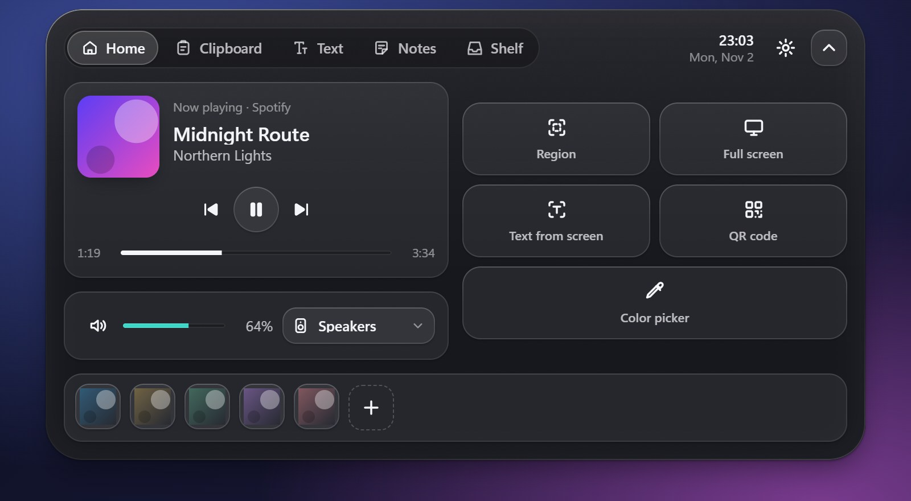</td>
    <td>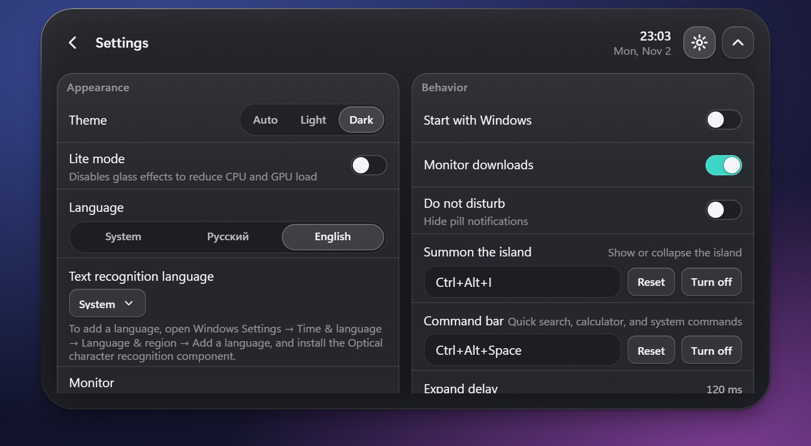</td>
  </tr>
  <tr>
    <td align="center"><sub>Home — player, volume, quick tools, dock</sub></td>
    <td align="center"><sub>Settings window — Features</sub></td>
  </tr>
  <tr>
    <td>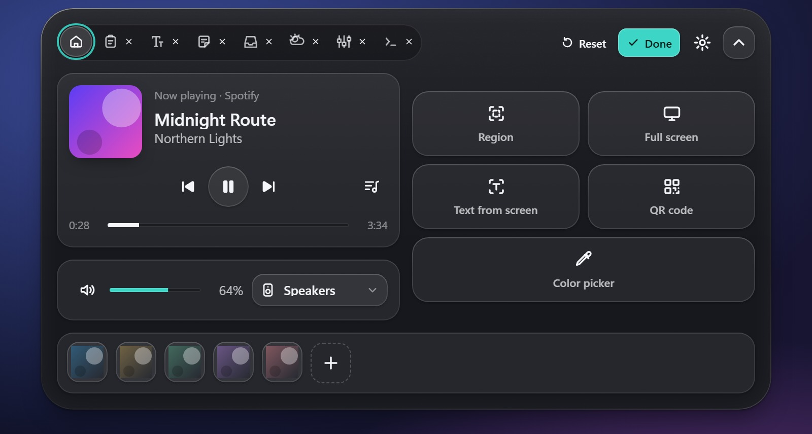</td>
    <td>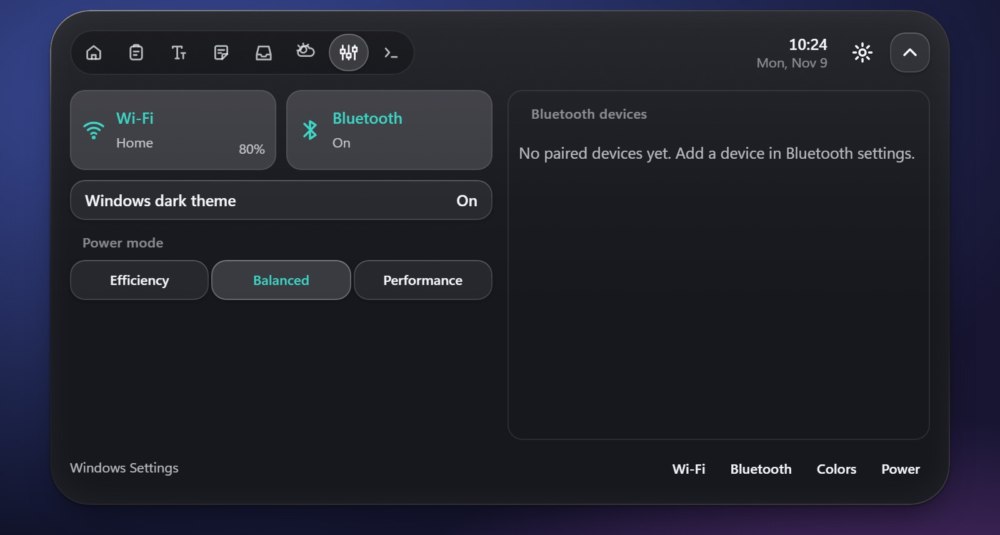</td>
  </tr>
  <tr>
    <td align="center"><sub>Reorder, hide and restore tabs</sub></td>
    <td align="center"><sub>Wi-Fi, Bluetooth, theme, power and devices</sub></td>
  </tr>
  <tr>
    <td>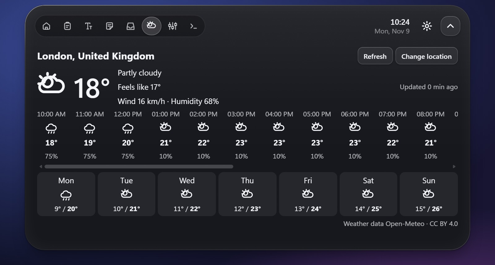</td>
    <td>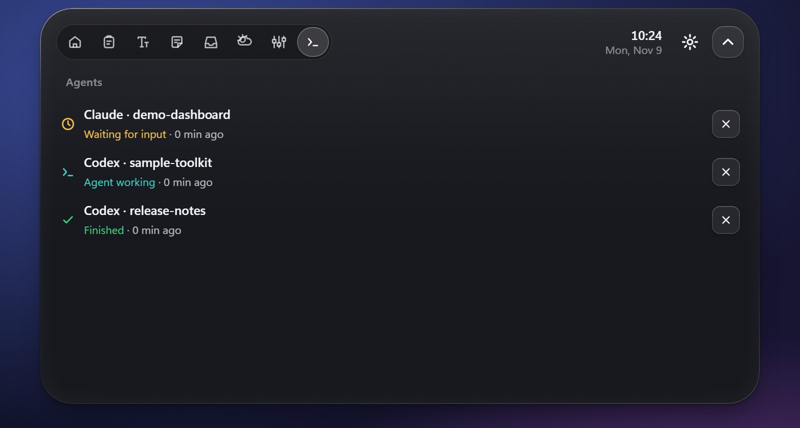</td>
  </tr>
  <tr>
    <td align="center"><sub>Weather — hourly and 7-day forecasts</sub></td>
    <td align="center"><sub>Agents — waiting, working and done</sub></td>
  </tr>
  <tr>
    <td>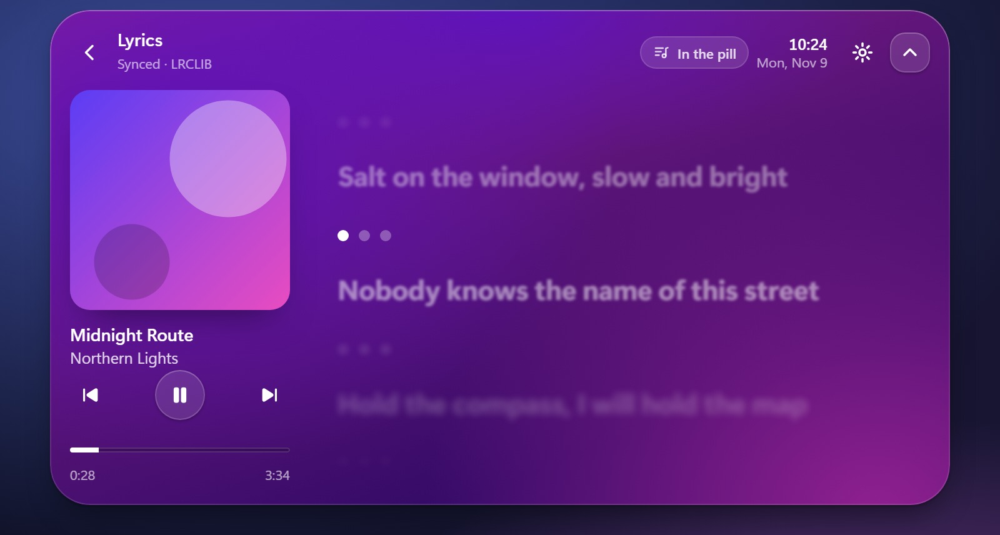</td>
    <td>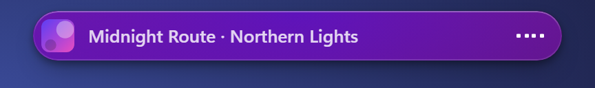</td>
  </tr>
  <tr>
    <td align="center"><sub>Synced lyrics — invented sample lines</sub></td>
    <td align="center"><sub>Current lyric line in the collapsed pill</sub></td>
  </tr>
  <tr>
    <td></td>
    <td>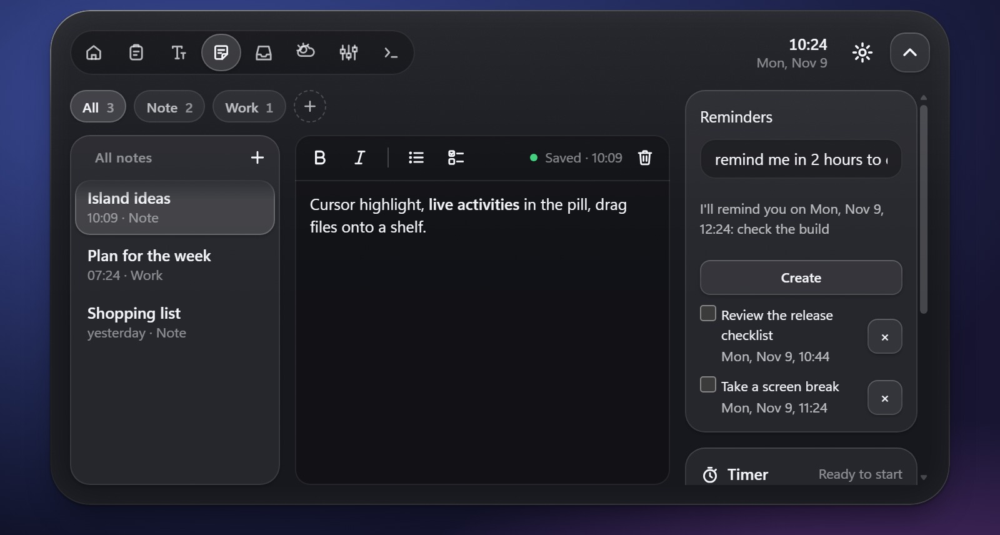</td>
  </tr>
  <tr>
    <td align="center"><sub>Drop onto the pill — Dock or Shelf</sub></td>
    <td align="center"><sub>Notes — reminders in natural language</sub></td>
  </tr>
  <tr>
    <td>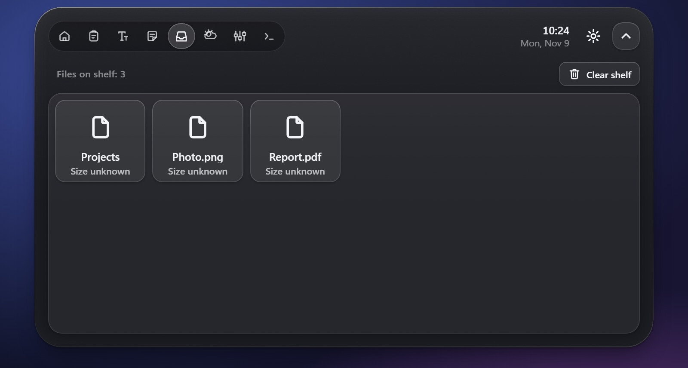</td>
    <td>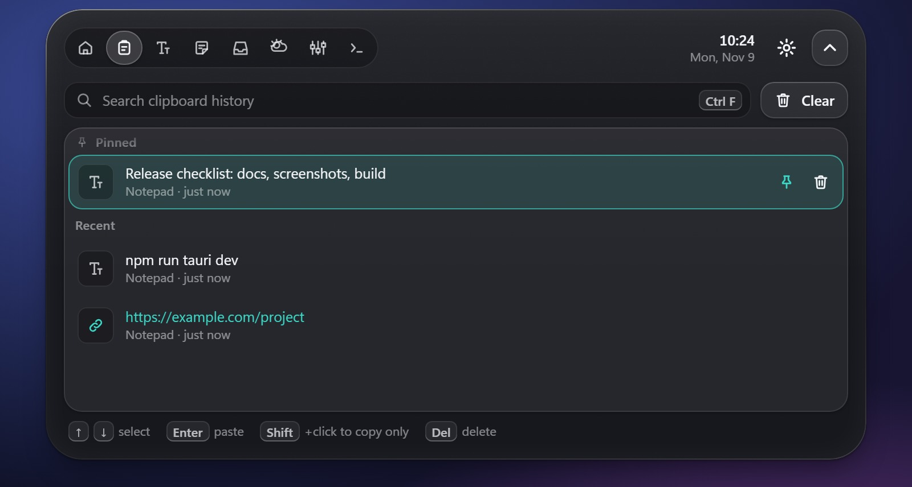</td>
  </tr>
  <tr>
    <td align="center"><sub>File shelf</sub></td>
    <td align="center"><sub>Clipboard history with pinned items</sub></td>
  </tr>
  <tr>
    <td>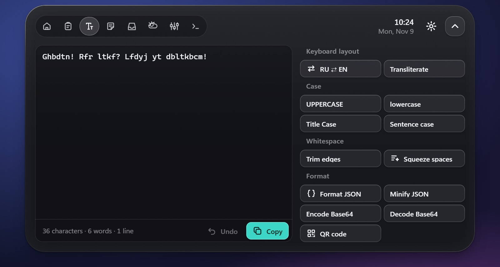</td>
    <td>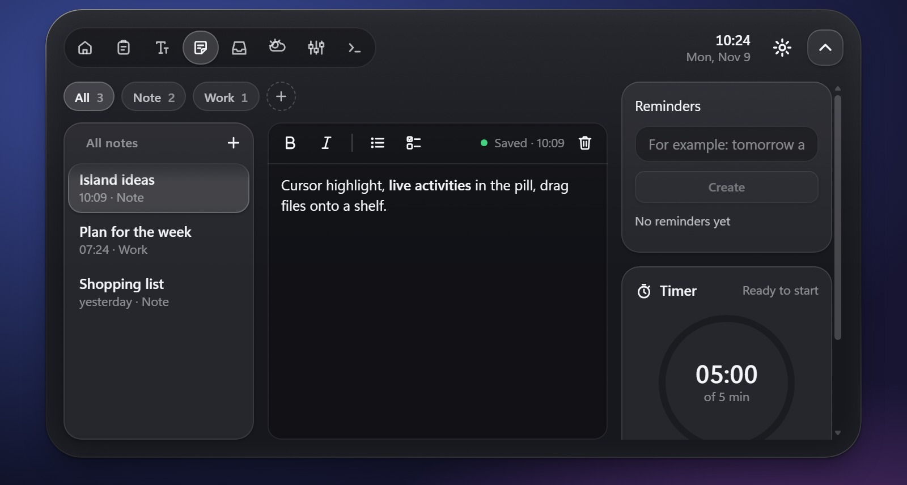</td>
  </tr>
  <tr>
    <td align="center"><sub>Text tools</sub></td>
    <td align="center"><sub>Notes and focus timer</sub></td>
  </tr>
  <tr>
    <td></td>
    <td>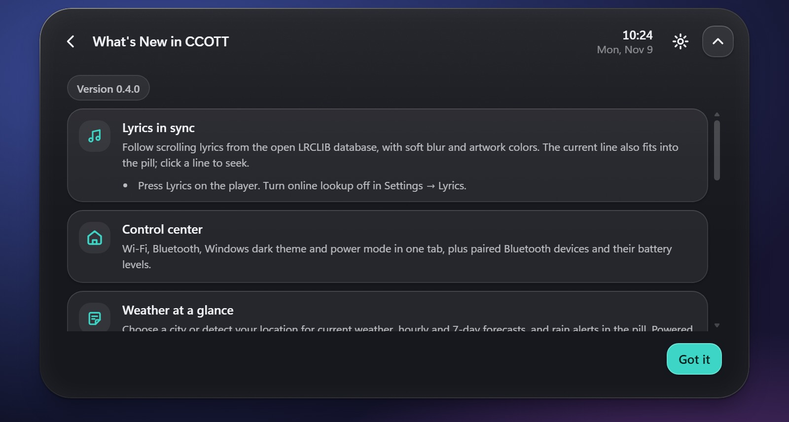</td>
  </tr>
  <tr>
    <td align="center"><sub>Command bar — currency conversion</sub></td>
    <td align="center"><sub>What's new in CCOTT 0.4.0</sub></td>
  </tr>
  <tr>
    <td></td>
    <td></td>
  </tr>
  <tr>
    <td align="center"><sub>Collapsed pill — now playing</sub></td>
    <td align="center"><sub>Collapsed pill — download progress</sub></td>
  </tr>
  <tr>
    <td>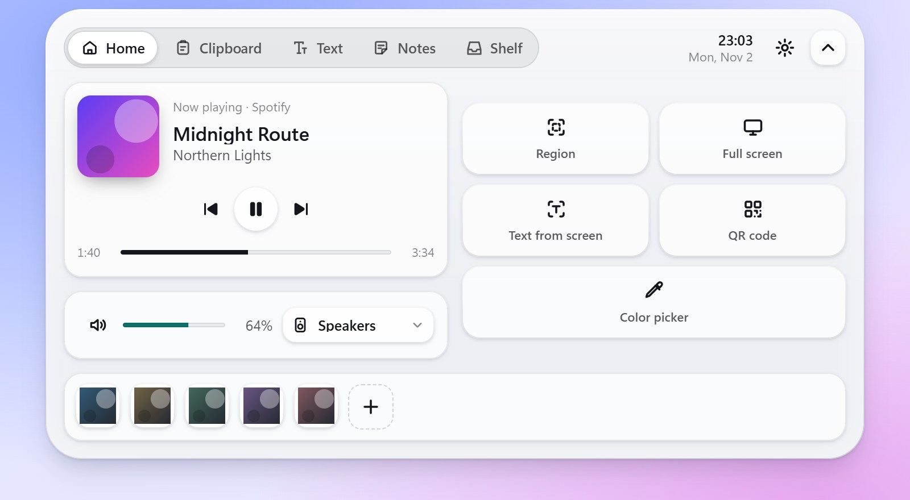</td>
    <td>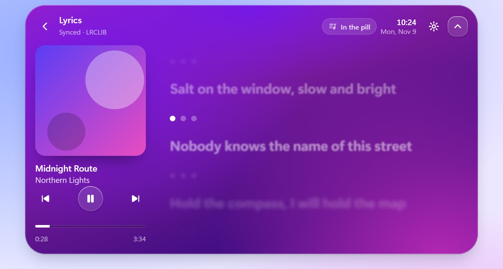</td>
  </tr>
  <tr>
    <td align="center"><sub>Light theme</sub></td>
    <td align="center"><sub>Synced lyrics — light theme</sub></td>
  </tr>
</table>

<sub>Screenshots use sample data; all lyric lines are invented. The release capture script also produces light-theme variants of the panel views.</sub>

## Download

Grab the installer from the [**latest release**](https://github.com/sshyngys1/ccott/releases/latest):

- `CCOTT_x.y.z_x64-setup.exe` — recommended installer (per-user, no admin rights needed);
- `CCOTT_x.y.z_x64_en-US.msi` / `..._ru-RU.msi` — MSI packages for managed deployments.

Requirements: Windows 11 (Windows 10 may work but is not tested) and the Microsoft Edge WebView2 Runtime, which
ships with Windows 11.

> [!NOTE]
> The installer is not code-signed yet, so Windows SmartScreen may show "Windows protected your PC".
> Click **More info → Run anyway**. Updates themselves are cryptographically signed and verified.

## Using CCOTT

| Action | How |
| --- | --- |
| Open the panel | Hover the pill at the top of the screen |
| Summon / hide anywhere | `Ctrl+Alt+I` (change it in Settings); `Esc` closes it again |
| Command bar | `Ctrl+Alt+Space` (change or turn off in Settings → Hotkeys; if it is taken, CCOTT picks a free one and tells you). `Enter` runs, `Ctrl+Enter` runs as admin / shows the file in Explorer, `Esc` closes |
| Park files on the shelf | Drag files onto the collapsed pill and choose **Shelf**; take them out from the **Shelf** tab (`Ctrl`/`Shift`+click selects several) |
| Arrange Home | Settings → Home → **Customize**: drag to reorder, × removes, the corner button switches 1×1 ⇄ 2×1, + adds |
| Show the hidden pill over a browser | Hold the cursor at the top edge of the screen for a moment |
| Pin an app, folder or file | Drag it onto the dock area of the expanded Home tab, or press `+` in the dock |
| Screenshot / text from screen | Click a tile on Home and drag a region; `Esc` or right click cancels |
| Paste from history | Click an entry, or select it with `↑` `↓` and press `Enter` |
| Copy without pasting | `Shift`+click or `Shift`+`Enter` |
| Change volume | Scroll over the volume card |
| Edit tabs | Right-click the tab strip → **Edit tabs**; drag to reorder, × hides, + restores, **Done** finishes |
| Show synced lyrics | Press **Lyrics** on the player; click a line to seek, `Esc` goes back |
| Connect coding agents | Open Settings → **Agents** and press **Connect** for Claude Code or Codex; CCOTT backs up the configuration before adding hooks |
| Settings, autostart, quit | Gear icon opens the separate Settings window; the tray icon also offers Settings and Quit |

## Privacy

Clipboard history, notes and reminders stay in a local SQLite database; settings are stored in `settings.json` alongside it in `%APPDATA%\dev.islandwin.app`. The agent monitor uses only a local named pipe, with no network connection and no conversation content.

CCOTT makes only these network requests:

- **Lyrics:** when online lookup is enabled (the default), track title, artist, album and duration go to [LRCLIB](https://lrclib.net). Turn lookup off in Settings → Lyrics, or disable the Lyrics feature, to stop these requests.
- **Weather:** the selected location’s coordinates go to Open-Meteo for forecasts; city searches go to its geocoding service. You can choose a city manually or use Windows location detection. Disabling Weather stops its requests.
- **Currencies:** currency codes are used to fetch exchange rates; rates are cached for 12 hours.
- **Updates:** GitHub Releases is checked for updates, in the background or on demand.

Nothing else is sent over the network. The downloads monitor and shelf read local file names and sizes. Clipboard entries marked as private by password managers are skipped, and copied text that looks like a password is masked in the pill.

## Build from source

Requirements: Node.js 24+, a stable Rust toolchain (MSVC), Visual Studio Build Tools with
**Desktop development with C++**, and the WebView2 Runtime.

```powershell
git clone https://github.com/sshyngys1/ccott.git
cd ccott
npm ci
npm run tauri dev      # run the app
npm run dev            # UI only, in a browser with mock data (http://localhost:1420)
npm run tauri build    # installers in src-tauri/target/release/bundle/
```

Checks:

```powershell
npm run typecheck
npm test
cargo test --manifest-path src-tauri/Cargo.toml
cargo clippy --manifest-path src-tauri/Cargo.toml --all-targets -- -D warnings
```

### Project layout

| Path | Purpose |
| --- | --- |
| `src/shell/` | Island window, pill, navigation, command bar, settings |
| `src/modules/` | Home, Clipboard, Text, Notes and Shelf tabs |
| `src/design/` | Design tokens, glass styles, icons, motion |
| `src/ipc/` | Typed calls to Rust and the browser mock |
| `src/lib/` | Module logic and state |
| `src-tauri/src/` | Rust backend: window, media (SMTC), audio, clipboard, storage, hotkeys, updater |
| `docs/` | IPC contracts, design spec, release guide |

Built with [Tauri 2](https://tauri.app), Rust, React 19, TypeScript, Vite, Motion, Zustand and SQLite.

## Roadmap

| Version | Planned |
| --- | --- |
| ✅ **0.2** — Quick tools | English interface, screenshots, offline OCR, color picker, QR codes, app and folder dock, auto-hide over browsers, automated release builds |
| ✅ **0.2.x** | Bug fixes, lighter on memory and CPU, first animations |
| ✅ **0.3** — Command bar & files | Command bar on a hotkey (apps, files, calculator, unit and currency converter, quick timers), file shelf, downloads monitor, customizable Home tiles, Lite mode, new animations |
| **0.3.x** | Bug fixes from Issues, winget package |
| ✅ **0.4** — Info & controls (released) | Synced lyrics, weather and rain alerts, control center, natural-language reminders, Claude Code and Codex status, separate Settings window, optional features and editable tabs, Dock or Shelf drop choice, download progress, headphone connection pill, currency autocomplete and a default currency |
| **0.5** — Media & polish | Smooth expansion on 120 Hz+ displays without stalls, MP4 screen recording, native Mica/Acrylic backdrop and improved glass |
| **1.0** — Stable | Code-signed installer, idle footprint under 60 MB RAM and 0% CPU, Windows 10 and multi-monitor/mixed-DPI testing, docs for writing modules |
| **Later** | Windows notifications in the pill, original desktop pets, optional AI features (bring your own key or a local model) |

Plans may change based on feedback.

Ideas and bug reports are welcome in [Issues](https://github.com/sshyngys1/ccott/issues).

## Credits

- [@sshyngys1](https://github.com/sshyngys1) — author and maintainer.
- [@bekbolatniaz-max](https://github.com/bekbolatniaz-max) — animations and motion effects.

## Contributing

See [CONTRIBUTING.md](CONTRIBUTING.md). Releases are described in [docs/RELEASING.md](docs/RELEASING.md).

## License

[PolyForm Noncommercial 1.0.0](LICENSE) © 2026 sshyngys1. Free to use, study, modify and share for any noncommercial purpose; selling CCOTT or a modified version, or other commercial use, needs the author's written permission. Versions up to 0.2.1 were released under MIT.

CCOTT is an independent project inspired by the Dynamic Island idea and is
not affiliated with Apple or Microsoft.
